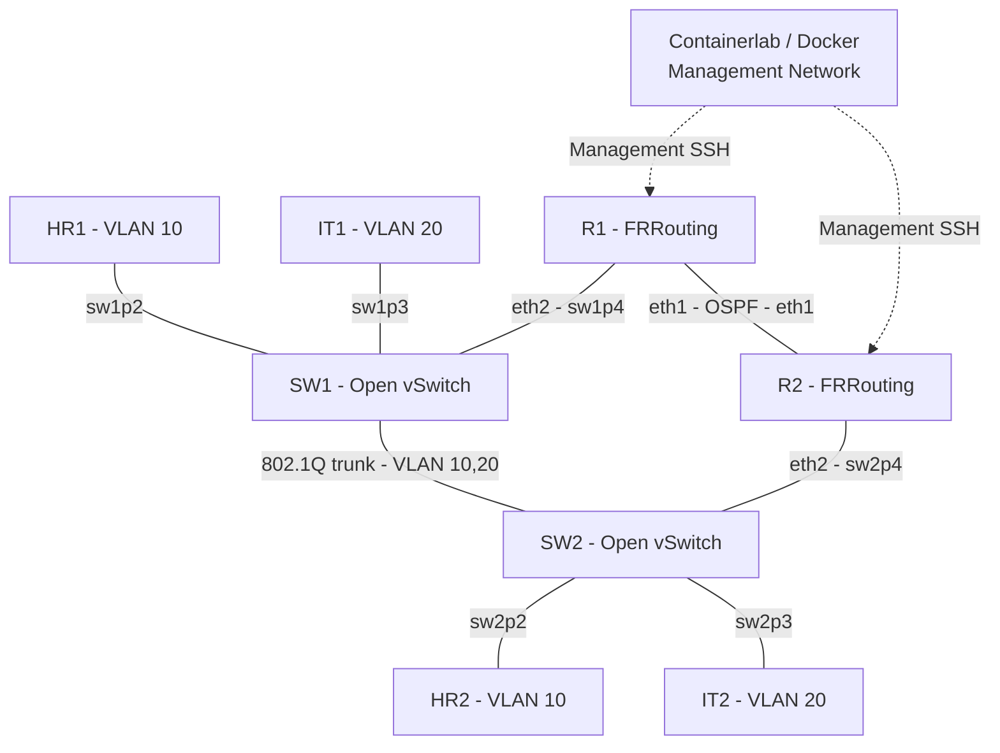

# Network Troubleshooting Intelligence Platform

A Python-based troubleshooting platform for a reproducible virtual network lab. It collects routing, interface, switching, and Syslog evidence, compares the observed state with a known-good baseline, and produces diagnostic reports that identify the affected component, supporting evidence, and recommended action.

The focus is on **traceable troubleshooting**: a finding must be supported by what the lab actually reported. An unavailable device, an interface failure, and an OSPF adjacency failure are treated as different observations. Diagnosis is initiated on demand, not through continuous autonomous monitoring.

## Network topology

The lab runs under WSL2 with Docker and Containerlab. Two FRRouting routers provide the routed portion of the lab, two Open vSwitch bridges provide VLAN switching, and four lightweight Linux hosts are used for end-to-end connectivity tests.



| Component | Function |
| --- | --- |
| **R1, R2** | FRRouting routers with an OSPF adjacency and monitored interface state |
| **SW1, SW2** | Open vSwitch bridges with access ports and VLAN trunks |
| **HR1, HR2** | VLAN 10 endpoints used to test the path across SW1 and SW2 |
| **IT1, IT2** | VLAN 20 endpoints used as a second, independent connectivity check |
| **Management network** | Access to router diagnostics independently of the particular data-plane path under test |

The two VLANs are isolated from one another. No inter-VLAN routing is required for these tests. For a trunk fault, the relevant question is whether traffic for a particular VLAN can traverse the expected switch-to-switch path, not merely whether a switch port is operationally up.

The lab topology is defined in [`lab/ospf-test.clab.yml`](lab/ospf-test.clab.yml). Expected healthy interface, OSPF, and switch-port state is recorded in [`lab/configs/healthy_baseline.json`](lab/configs/healthy_baseline.json).

## Technology stack

| Technology | Use in the project |
| --- | --- |
| **WSL2 / Linux** | Local development and networking environment |
| **Docker + Containerlab** | Repeatable lab deployment and container lifecycle |
| **FRRouting (FRR)** | Router configuration, OSPF adjacency, interface evidence |
| **Open vSwitch (OVS)** | Access-port and trunk configuration, VLAN inspection |
| **Python** | Evidence collection, parsing, diagnostic rules, reports, test runners |
| **SSH** | Router diagnostic command collection using a restricted service account |
| **Syslog / UDP** | Transport and collection of router events |
| **SQLite** | Persistent evidence and Syslog storage |
| **Shell scripts** | Lab setup, SSH provisioning, verification, and recovery |

## System architecture

```text
FRRouting routers ---- SSH diagnostic commands -----------+
Open vSwitch --------- Port/configuration inspection ------+--> Evidence collection
FRRouting log output - Syslog receiver / importer --------+
                                                                  |
                                                                  v
                                                        SQLite evidence store
                                                                  |
                                             Parsing, normalization, provenance
                                                                  |
                                               Known-good baseline comparison
                                                                  |
                                            Deterministic troubleshooting checks
                                                                  |
                                           Text report + supported recommendation
```

A standard diagnosis cycle evaluates **12 checks**: two router interfaces, two OSPF neighbor states, and eight switch ports. The checks use the most recent valid evidence available in the local store and identify missing, failed, or stale observations rather than assuming a healthy result.

### 1. Lab deployment and recovery

[`deploy-lab.sh`](lab/scripts/deploy-lab.sh) sets up the virtual network and checks whether the expected routing and switching state is usable. [`restore-network.sh`](lab/scripts/restore-network.sh) handles network restoration after lab changes, including host addresses and switching state where necessary.

Deployment validation goes beyond checking whether containers are running. An FRRouting container can be reachable while its OSPF process is not ready, and a host interface can be up without having the expected IPv4 address. These states require separate checks.

### 2. SSH collection and access control

[`ssh_collector.py`](lab/scripts/ssh_collector.py) obtains diagnostic output from R1 and R2. Inspected state includes:

- `show ip ospf neighbor` — whether the OSPF adjacency is present and in the expected state.
- `show interface eth1` — interface and line-protocol state for the monitored router link.

A dedicated `collector` account is provisioned with a restricted command handler using [`provision_readonly_ssh.sh`](lab/scripts/provision_readonly_ssh.sh) and [`readonly_ssh_command.sh`](lab/scripts/readonly_ssh_command.sh). SSH host keys are checked against a local known-hosts file. The collector records failed and timed-out commands instead of silently dropping them.

Router evidence records identify the device, command, collection outcome, command output, and collection timestamp. Diagnostic collection is separated from the privileged commands used to inject faults in the isolated test lab.

### 3. Switch evidence

[`switch_collector.py`](lab/scripts/switch_collector.py) inspects Open vSwitch port configuration, including:

- Port identity and VLAN mode.
- Access VLAN tag.
- Allowed VLANs on trunk ports.
- Whether the observed state matches the recorded baseline.

The collector normalizes OVS output before it is evaluated. That matters when a trunk allows VLAN 20 but excludes VLAN 10: the port can still be up, and VLAN 20 can continue working, while the VLAN 10 service path is interrupted.

### 4. Syslog collection

[`syslog_receiver.py`](lab/scripts/syslog_receiver.py) receives UDP events from the lab. [`forward_frr_logs.py`](lab/scripts/forward_frr_logs.py) forwards FRRouting container output, and [`syslog_importer.py`](lab/scripts/syslog_importer.py) imports supported events into SQLite.

The event pipeline preserves relevant source and timing information and avoids re-importing identical raw log lines. Receive time and event time are not interchangeable: their distinction matters when comparing a configuration change with an incident observation.

### 5. Evidence storage and provenance

[`evidence_db.py`](lab/scripts/evidence_db.py) manages the local SQLite evidence store. The core records include `evidence_records` for device observations and `syslog_events` for ingested events.

Evidence is associated with collection status, time, source, and an identifiable record ID. [`evidence_provenance.py`](lab/scripts/evidence_provenance.py) links reported findings back to these observations. Runtime databases and raw logs remain local; they are not included in this repository.

The unified collector in [`collect_all.py`](lab/scripts/collect_all.py) runs router SSH collection, switch collection, and Syslog import. A failure in one collector is reported without silently treating its missing output as valid network state.

### 6. Diagnostic engine and reports

The diagnostic implementation is split into parsers and focused checks rather than a single script:

- [`evidence_parser.py`](lab/scripts/evidence_parser.py) and [`ovs_normalization.py`](lab/scripts/ovs_normalization.py) normalize observations.
- [`interface_diagnosis.py`](lab/scripts/interface_diagnosis.py) evaluates interface-state findings.
- [`ospf_diagnosis.py`](lab/scripts/ospf_diagnosis.py) evaluates neighbor state and available supporting events.
- [`vlan_diagnosis.py`](lab/scripts/vlan_diagnosis.py) evaluates trunk VLAN configuration.
- [`state_comparator.py`](lab/scripts/state_comparator.py) compares observed state with the known-good baseline.
- [`diagnosis_engine.py`](lab/scripts/diagnosis_engine.py) combines the device checks.
- [`diagnosis_report.py`](lab/scripts/diagnosis_report.py) produces a human-readable report with evidence and recommendations.

A report can identify the observed failure, affected device or port, available source records, possible cause, recommended next action, and evidence limitations. A failed management collection does **not** prove that a router is down. Similarly, an interface being up does **not** prove that OSPF has formed a neighbor relationship.

The configuration-change analysis uses snapshots, service-path relevance, and event ordering. A change is treated as a possible explanation only when the independent observations support that interpretation; timing alone is not proof of causation.

## Troubleshooting scenarios and validation

The system was tested using controlled fault injection, healthy-state controls, and variations in the virtual lab. Each test checks the observed network behavior and the diagnostic evidence. Where a fault changes lab state, recovery is checked before the next run.

| Scenario | Investigation | Recorded runs | Passed |
| --- | --- | ---: | ---: |
| **S01 — VLAN missing from trunk** | Identify the affected VLAN and switch trunk; distinguish VLAN-specific loss from an overall link outage | 8 | 8 |
| **S02 — OSPF adjacency down** | Detect a missing OSPF neighbor while the monitored interface remains up | 4 | 4 |
| **S03 — Interface/uplink down** | Identify a down data-plane interface without confusing it with management reachability | 4 | 4 |
| **S04 — Configuration-change correlation** | Compare incident evidence with a relevant, unrelated, later, or absent change | 4 | 4 |
| **Total** | | **20** | **20** |

Across these **20 recorded lab runs**, evidence collection succeeded in all 20. Recovery was verified in **14** runs and marked **not required** in the other **6**. The case-by-case outcomes are recorded in [`lab/docs/MVP_TEST_MATRIX.csv`](lab/docs/MVP_TEST_MATRIX.csv).

### What the tests demonstrate

**S01 — VLAN trunk faults.** Removing VLAN 10 from a trunk causes the VLAN 10 endpoint path to fail while VLAN 20 remains available. The diagnosis must identify the missing VLAN and the relevant trunk port, supported by the observed trunk configuration and connectivity checks. Healthy controls and variations prevent the test from succeeding simply by treating every trunk as faulty.

**S02 — OSPF neighbor faults.** The interface can remain operational while OSPF adjacency is missing. Interface state and protocol neighbor state are evaluated independently, so the finding is not reduced to a generic "link down" explanation.

**S03 — Interface/uplink faults.** A data-plane interface fault is evaluated without assuming that loss of the tested path also means the router or its management access is unavailable. Recovery confirms whether the intended healthy state was restored.

**S04 — Configuration-change correlation.** The project distinguishes a plausible contributing change from changes that do not explain the service impact:

| Run | Recorded assessment | Meaning |
| --- | --- | --- |
| `S04-F01` | `candidate_for_investigation` | Change is relevant to investigate; causation is not established |
| `S04-F02` | `no_direct_link_found` | Examined change was outside the affected service path |
| `S04-F03` | `not_initial_trigger` | Examined change happened after the incident was observed |
| `S04-F04` | `no_change_detected` | No corresponding configuration change was found |

These are controlled lab results, not 20 independent production incidents. The CSV matrix contains the test identifiers, expected and observed conditions, evidence record references, run outcomes, and stated measurement limitations. Some rows reference local JSON evidence files that are intentionally not part of this source repository.

### Python regression tests

The Python test suite covers parsing, Open vSwitch normalization, change correlation, and test-runner safeguards, including recovery and collection-failure paths.

```bash
PYTHONPATH=lab/scripts python3 -m unittest discover -s lab/tests -p 'test_*.py' -v
```

**Latest run against the public-source copy: 30 tests executed, all 30 passed.** Several tests deliberately simulate failures; those messages are expected test inputs, not failures of the test suite or additional network fault runs.

## Repository layout

```text
network-troubleshooting-intelligence-platform/
├── README.md
├── .gitignore
└── lab/
    ├── ospf-test.clab.yml          # Containerlab network topology
    ├── configs/
    │   ├── healthy_baseline.json   # Expected healthy state
    │   ├── r1/frr.conf
    │   └── r2/frr.conf
    ├── docs/
    │   ├── MVP_TEST_MATRIX.csv     # 20 recorded lab-run outcomes
    │   └── MVP_TEST_PLAN.md       # Public test-case ID registry
    ├── scripts/                   # Deployment, collection, diagnosis, runners
    └── tests/                     # Python regression tests
```

## Running the lab

This project is designed for an **isolated networking lab**, not a production network. It was developed on WSL2 and uses Docker, Containerlab, Open vSwitch, FRRouting container images, and Python 3. The scripts require appropriate local networking and Docker permissions.

### Deploy

From the repository root:

```bash
cd lab
sudo sh scripts/deploy-lab.sh
cd ..
```

The deployment script verifies lab readiness and includes recovery checks. Review the script and its local prerequisites before running it on a different machine.

### Start the log pipeline

Run the receiver and forwarder in separate terminals, from the repository root:

```bash
python3 lab/scripts/syslog_receiver.py
```

```bash
python3 lab/scripts/forward_frr_logs.py
```

The receiver uses a lab management address and UDP port `5514`; the configured address must match the local Docker/Containerlab setup. UDP delivery is not guaranteed.

### Collect and diagnose

```bash
python3 lab/scripts/collect_all.py
python3 lab/scripts/diagnosis_report.py
```

The SSH collector requires a locally configured public/private key pair, verified host keys (such as a dedicated `~/.ssh/clab_known_hosts` file), and the expected management reachability. The restricted collector account must be provisioned for the environment before collection. Do not place SSH private keys or credentials in the repository.

Fault-injection runners under `lab/scripts/` modify the isolated lab's configuration or links. Review their preflight and restoration behavior before executing them. The Python regression test command above does not deploy or intentionally break the live network.

## Engineering lessons from the lab

The investigation workflow was shaped by faults encountered while building the environment:

- **Host IP missing after topology changes.** A recreated link left a host interface `UP` but without its expected IPv4 address. Recovery had to check addressing as well as link state.
- **OSPF readiness after router recreation.** A running container was not proof of a healthy neighbor adjacency. The deployment checks validate OSPF state explicitly.
- **Virtual Ethernet conflicts.** Recreating links and existing interfaces required careful handling of container/network state during deployment.
- **SSH host-key changes after rebuilding nodes.** Collection uses host-key verification and treats trust failures as collection problems, not network diagnoses.
- **Syslog timing and provenance.** Event timestamps, receive timestamps, and collection timestamps must be distinguished before drawing conclusions from event order.
- **Failure recovery.** The test runners check for duplicate run identifiers, record failed collection or diagnosis paths, and verify or report recovery outcomes.

These observations explain some of the implementation safeguards; they are not additional scored test scenarios.

## Limitations

- Investigation is **initiated on demand**. The project does not claim continuous fault detection or unattended remediation.
- Recorded collection time and report-processing time are **not** equivalent to detection latency from an unknown fault onset. Automatic detection latency was not measured.
- The 20-run test matrix demonstrates behavior only for the documented lab topology and test variations. It is not a production accuracy estimate.
- Configuration-change correlation indicates relevance or lack of direct support, not automatically proven root cause.
- UDP Syslog can lose events; SSH collection can fail; and observations can become stale. Such conditions must remain visible in the report.
- Runtime databases, collected raw logs, temporary artifacts, and local SSH material are excluded from the published source files.

The report is intended to answer four practical questions: **what failed, what was observed, why the finding is supported, and what should be checked or corrected next.**
